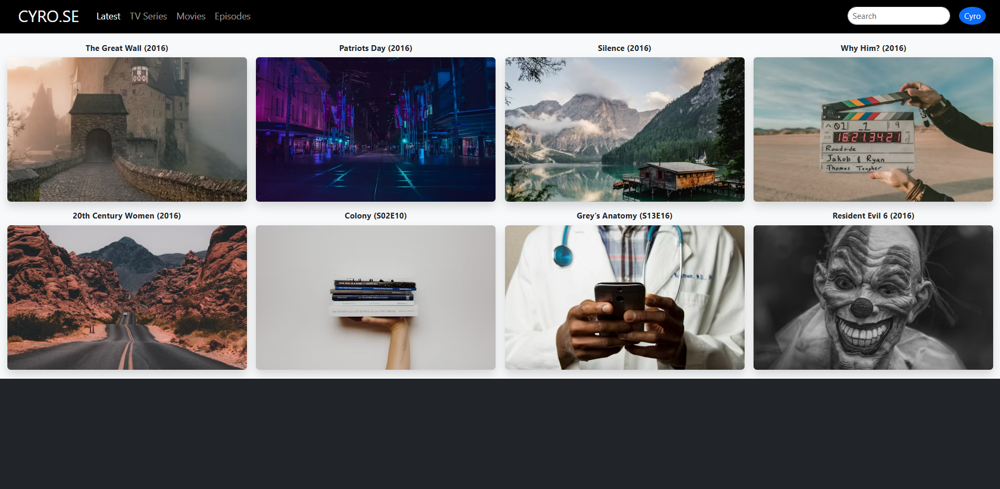
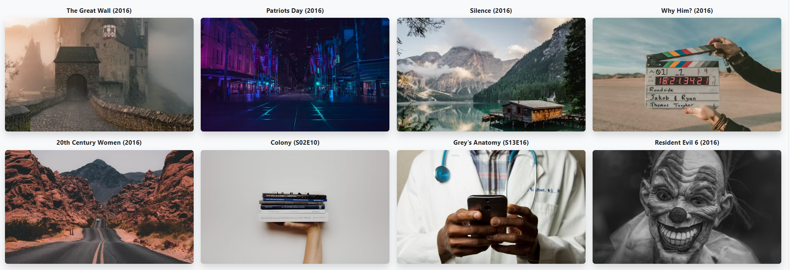

# CYRO.SE - Movie Website

A responsive and interactive movie catalog website developed using ReactJS and Bootstrap 5. The website allows users to browse movie posters, explore different categories, search for movies, and view movie details through an interactive user interface.

The project is inspired by a movie catalog website design and demonstrates the use of React components, state management, JavaScript array methods, and Bootstrap responsive utilities.

---

## Table of Contents

1. Project Overview
2. Objectives
3. Features
4. Technologies Used
5. Project Structure
6. Installation and Setup
7. Running the Project
8. User Interface
9. Navbar and Navigation
10. Movie Catalog
11. Search Functionality
12. Category Filtering
13. Movie Details Popup
14. ReactJS Concepts Used
15. Bootstrap Components and Classes
16. Styling Approach
17. Responsive Design
18. Application Workflow
19. Data Management
20. Error Handling
21. Limitations
22. Future Enhancements
23. Learning Outcomes
24. Conclusion

---

## Demo Video

Watch the project demo: [CYRO.SE Movie Website Demo]https://drive.google.com/file/d/1wnBv1XuzIpGkk6atnDLoz7swRntOnUmX/view?usp=sharing

---

## 1. Project Overview

CYRO.SE is a movie catalog website created using ReactJS and Bootstrap 5.

The main purpose of this project is to create a simple, attractive, and responsive interface where users can explore a collection of movies and television series.

The website displays movie posters, titles, release years, ratings, and categories. Users can search for movies by title, filter the displayed content using category buttons, and open a popup to view additional information about a selected movie.

The project focuses on frontend development and does not require a backend server or database.

Movie information is stored in a JavaScript array, and ReactJS is used to dynamically display and filter the content.

---

---

## Output Screenshots

### 1. Header

### 2. Home Page

### 3. Movie Catalog

## 2. Objectives

The main objectives of this project are:

- To develop an interactive movie catalog using ReactJS.
- To create a responsive layout using Bootstrap 5.
- To display movie information using reusable React rendering patterns.
- To implement search functionality using JavaScript.
- To filter movies according to their categories.
- To use React state management for interactive features.
- To display movie details using a popup interface.
- To improve understanding of JavaScript array methods.
- To design a website that works on desktop and mobile devices.
- To practice frontend development without creating a separate CSS file.

---

## 3. Features

### 3.1 Responsive Navigation Bar

The website includes a navigation bar containing the CYRO.SE logo and category buttons.

The available categories are:

- Latest
- TV Series
- Movies
- Episodes

Users can select a category to filter the displayed movie cards.

### 3.2 Movie Cards

Each movie card displays:

- Movie title
- Release year or episode identifier
- Movie poster
- Additional information on hover

The cards are arranged in a responsive grid using Bootstrap.

### 3.3 Search Functionality

The search bar allows users to search for movies by title.

As the user enters text, the movie list updates automatically to display matching titles.

The search is case-insensitive.

For example, searching for "silence" will match a movie titled "Silence".

### 3.4 Category Filtering

Users can select different categories from the navigation bar.

The available categories are:

- Latest: Displays all available entries.
- Movies: Displays entries categorized as movies.
- TV Series: Displays entries categorized as television series.
- Episodes: Displays entries whose year field contains the letter "E", according to the current implementation.

The search bar can also be used together with category filtering.

### 3.5 Movie Poster Hover Effect

When the user moves the pointer over a movie poster, an information overlay appears.

The overlay displays:

- Movie title
- Rating
- MPAA rating
- Video quality
- Movie category

This feature provides additional information without navigating away from the main page.

### 3.6 Movie Details Popup

When a user clicks a movie card, a popup displays additional information.

The popup includes:

- Movie title
- Release year
- Rating
- Category
- Short description
- Watch Trailer button

The popup can be closed using the close button or by clicking outside the popup.

### 3.7 Responsive Layout

Bootstrap grid classes are used to adjust the number of movie cards according to screen size.

The layout displays:

- Two columns on small screens.
- Three columns on medium screens.
- Four columns on large screens.

This allows the website to adapt to different devices.

### 3.8 Sample Movie Data

The application uses sample movie information stored in a JavaScript array.

Each movie object contains properties such as its ID, title, year, category, rating, poster URL, and description.

The sample data can be expanded by adding more objects to the array.

---

## 4. Technologies Used

### ReactJS

ReactJS is used to build the user interface and manage interactive functionality.

It allows the website to update displayed content when users change categories, enter search text, or select a movie.

### Bootstrap 5

Bootstrap 5 is used to create the responsive layout and style the user interface.

It provides predefined classes for navigation bars, grids, buttons, spacing, backgrounds, and other interface elements.

### JavaScript

JavaScript handles the application's logic, including search, filtering, event handling, and state updates.

### HTML5

HTML5 provides the basic document structure through the React application's entry HTML file and JSX elements.

### Vite

Vite provides the development server and build tools used to run the React project.

---

## 5. Project Structure

The project uses the following folder structure:

    cyrose-movie-website/
    |
    |-- node_modules/
    |
    |-- src/
    |   |
    |   |-- App.jsx
    |   |-- main.jsx
    |
    |-- index.html
    |-- package.json
    |-- package-lock.json
    |-- README.md

### File Descriptions

**App.jsx**

Contains the main application component, movie data, navigation bar, movie grid, search functionality, category filtering, and movie details popup.

**main.jsx**

Serves as the entry point of the React application. It imports React, Bootstrap CSS, and the App component before rendering the application.

**index.html**

Contains the HTML document and the root element where React renders the application.

**package.json**

Contains project metadata, dependencies, and development scripts.

**README.md**

Documents the project, its features, setup instructions, technologies, and functionality.

**node_modules**

Contains installed project dependencies. This directory is generated when dependencies are installed.

---

## 6. Installation and Setup

Follow these steps to install and configure the project.

### Step 1: Install Node.js

Install Node.js on your computer if it is not already installed.

Node.js provides the environment required to run the project's development tools.

### Step 2: Open the Project

Open the project folder in Visual Studio Code.

### Step 3: Open the Terminal

Open the integrated terminal in Visual Studio Code.

Make sure the terminal is located in the directory containing the package.json file.

### Step 4: Install Dependencies

Run the following command:

    npm install

This command installs the dependencies defined in package.json.

### Step 5: Install Bootstrap

If Bootstrap is not already installed, run:

    npm install bootstrap

Bootstrap is imported directly into main.jsx.

### Step 6: Start the Development Server

Run:

    npm run dev

Vite starts the local development server.

### Step 7: Open the Website

Open the local URL displayed in the terminal.

The application should now be available in your browser.

---

## 7. Running the Project

After installation, use the following command to start the development server:

    npm run dev

To create a production build, run:

    npm run build

The production-ready files are generated in the dist directory.

To preview the production build locally, run:

    npm run preview

These commands are available when the corresponding scripts are configured in package.json.

---

## 8. User Interface

The user interface is designed to resemble a movie catalog website.

It contains three main areas.

### Header Section

The header contains the website logo, navigation links, search bar, and profile button.

The dark background creates contrast with the lighter movie catalog section.

### Main Content Section

The main content displays movie cards arranged in a grid.

Each card contains the movie title and year above its poster.

The Bootstrap grid system controls the number of columns displayed at different screen sizes.

### Movie Information Section

The movie information overlay appears when the user hovers over a poster.

The movie details popup appears when a movie card is selected.

These features allow users to explore information without leaving the page.

---

## 9. Navbar and Navigation

The navigation bar is created using Bootstrap's navbar component.

The website includes four navigation categories:

- Latest
- TV Series
- Movies
- Episodes

The active category is stored in React state.

When a user clicks a category button, the state updates and the displayed movie list is filtered accordingly.

The navbar also includes a search input that allows users to search for movie titles.

Bootstrap's responsive navbar classes allow the navigation section to collapse on smaller screens.

---

## 10. Movie Catalog

The movie catalog is the main feature of the application.

Movie information is stored in an array of objects.

Each object represents one movie or series entry.

Example:

    {
      id: 1,
      title: "The Great Wall",
      year: "2016",
      category: "Movies",
      rating: "6.0",
      poster: "POSTER_IMAGE_URL",
      description: "A short movie description."
    }

### Movie Object Properties

**id**

A unique identifier for the movie.

**title**

The name displayed above the poster and in the details popup.

**year**

The release year or episode identifier.

**category**

The category used for filtering.

**rating**

The sample rating displayed on the website.

**poster**

The URL of the image displayed as the movie poster.

**description**

A short description displayed in the movie details popup.

### Rendering Movie Cards

The application uses JavaScript's map() method to generate movie cards from the array.

This avoids writing separate JSX markup for every movie.

When the array is updated, React can render the corresponding list of entries.

---

## 11. Search Functionality

The search feature allows users to find a movie by entering its title.

React state stores the text entered into the search input.

The application uses JavaScript's filter() method to create a list of matching movies.

The title is converted to lowercase before comparison.

This makes the search case-insensitive.

### Example

If the search input contains:

    silence

The application displays movie titles containing the text "silence", regardless of capitalization.

### Search Workflow

1. The user enters text into the search input.
2. The input event updates React state.
3. The application filters the movie array.
4. Matching movie cards are displayed.
5. If no matching entries exist, a "No movies found" message appears.

The search feature works together with category filtering.

---

## 12. Category Filtering

Category filtering allows users to browse selected types of content.

The application maintains the selected category in React state.

When a category button is clicked, the selected category is updated.

The movie array is filtered according to the selected category.

### Latest

Displays all entries in the current sample data.

### Movies

Displays entries whose category is Movies.

### TV Series

Displays entries whose category is TV Series.

### Episodes

The current implementation identifies entries whose year field contains the letter "E".

This behavior is based on the sample data structure and can be changed to use a separate episode property if required.

### Combined Search and Filtering

Search and category filtering operate together.

For example, selecting Movies and searching for a title displays only matching movie entries.

This makes the catalog easier to navigate.

---

## 13. Movie Details Popup

The movie details popup displays additional information about a selected movie.

When a user clicks a movie card, the selected movie is stored in React state.

The popup then displays information from that selected object.

### Information Displayed

- Title
- Year
- Rating
- Category
- Description
- Watch Trailer button

### Closing the Popup

The popup can be closed by clicking its close button.

It can also be closed by clicking the background outside the popup.

Clicking inside the popup does not close it because the click event is stopped from propagating to the background.

### Watch Trailer Button

The Watch Trailer button is currently a demonstration button.

It displays a message explaining that a legal video source must be connected for playback.

Actual trailer playback is not implemented.

---

## 14. ReactJS Concepts Used

### Functional Components

The application is built using a functional React component named App.

The component contains the interface and application logic.

### useState Hook

The useState hook manages interactive values.

The application uses state for:

- Selected category
- Search text
- Selected movie

When state changes, React updates the relevant interface.

### Event Handling

The application uses event handlers for:

- Clicking category buttons
- Entering search text
- Clicking movie cards
- Closing the details popup
- Clicking the Watch Trailer button

### Conditional Rendering

Conditional rendering displays different content according to the application's state.

For example, the application displays movie cards when matching results exist.

When no movies match, a message is displayed instead.

The details popup is displayed only when a movie has been selected.

### Array map() Method

The map() method converts movie objects into React elements.

It is used to generate navigation items and movie cards.

### Array filter() Method

The filter() method selects movie entries that match the chosen category and search text.

### Props and Data

The movie information is passed through JavaScript objects and accessed when rendering each card.

The selected movie object is used to display the corresponding details.

---

## 15. Bootstrap Components and Classes

Bootstrap provides the responsive layout and most of the visual styling.

### Navbar

The navbar classes create the navigation section.

Examples:

- navbar
- navbar-expand-lg
- navbar-dark
- navbar-brand
- navbar-nav
- nav-item
- nav-link
- navbar-toggler

### Grid System

The grid system arranges movie cards into columns.

Examples:

- container-fluid
- row
- col-6
- col-md-4
- col-lg-3
- g-3
- g-md-4

The grid adapts to different screen widths.

### Spacing Utilities

Bootstrap spacing classes control margins and padding.

Examples:

- p-3
- px-3
- py-3
- ms-lg-3
- mt-2
- mb-2

### Background Utilities

Background classes define the main colors.

Examples:

- bg-dark
- bg-black
- bg-light
- bg-opacity-75

### Text Utilities

Text classes control text appearance.

Examples:

- text-light
- text-dark
- text-center
- text-danger
- text-secondary
- fw-bold
- small

### Form Controls

The search field uses Bootstrap form classes.

Examples:

- form-control
- form-control-sm

### Buttons

Bootstrap button classes are used for actions.

Examples:

- btn
- btn-dark
- btn-primary
- btn-sm

### Other Utilities

Additional classes include:

- min-vh-100
- position-relative
- position-absolute
- position-fixed
- top-0
- start-0
- w-100
- h-100
- d-flex
- flex-column
- justify-content-center
- align-items-center
- rounded
- shadow
- overflow-hidden

These classes provide layout, spacing, positioning, and visual effects without requiring a separate CSS file.

---

## 16. Styling Approach

The project uses Bootstrap 5 utility classes and inline styles.

No separate App.css file is required.

Bootstrap handles most interface styling, including:

- Navigation bar layout
- Responsive grid
- Buttons
- Form controls
- Text formatting
- Background colors
- Spacing
- Positioning
- Popup layout

Inline styles are used for specific requirements such as poster height and image cropping.

The hover overlay uses React mouse event handlers to change its opacity.

This approach keeps the styling directly within the JSX while using Bootstrap for the main layout.

---

## 17. Responsive Design

Responsive design ensures that the website adapts to different screen sizes.

The project uses Bootstrap's grid system.

### Mobile Devices

Two movie cards are displayed per row.

### Medium Screens

Three movie cards are displayed per row.

### Large Screens

Four movie cards are displayed per row.

The navbar uses Bootstrap's responsive collapse classes.

This allows navigation links to be displayed in a collapsible menu on smaller screens.

The movie posters use responsive widths so that they fit within their columns.

---

## 18. Application Workflow

The application follows a simple workflow.

### Step 1: Application Initialization

React renders the App component into the root element.

### Step 2: Movie Data Loading

The application reads the sample movie array defined in App.jsx.

### Step 3: Displaying Movies

The map() method generates movie cards from the array.

### Step 4: Selecting a Category

The user clicks a category button.

React updates the selected category state.

### Step 5: Filtering Content

The application filters the movie array according to the selected category and search input.

### Step 6: Selecting a Movie

The user clicks a movie card.

The selected movie is stored in state.

### Step 7: Displaying Details

The popup displays information about the selected movie.

### Step 8: Closing Details

The user closes the popup to return to the movie catalog.

---

## 19. Data Management

The current application stores movie information in a JavaScript array.

This approach is suitable for a small frontend demonstration.

The application does not currently use a backend database.

Movie information is stored directly in the source code.

To add a movie, create a new object in the movies array with a unique ID and the required properties.

### Data Limitations

- Movie data is manually maintained.
- Search operates only on the available sample entries.
- Ratings are sample values.
- Movie descriptions are sample text.
- External poster images require an internet connection.

A future version could retrieve movie information from a movie database API.

---

## 20. Error Handling

The application includes basic handling for missing movie images.

If a poster image fails to load, the image error handler replaces it with a placeholder image.

The search interface also handles cases where no movie matches the search text.

In that situation, the application displays a message and provides a button to reset the search and category selection.

These features improve the usability of the demonstration.

---

## 21. Limitations

The current version is a frontend-only project.

The following features are not implemented:

- Backend integration
- Database storage
- User authentication
- User profiles
- Actual movie streaming
- Actual trailer playback
- Watchlist storage
- Automatic movie information retrieval
- Real-time ratings and reviews

The movie information is based on sample data.

External images may occasionally become unavailable.

---

## 22. Future Enhancements

The project can be improved by adding the following features.

### Movie Database API

Integrate a movie database API to retrieve real movie information, ratings, descriptions, and posters.

### Watchlist

Allow users to add movies to a personal watchlist.

### Favorites

Add a favorites feature so users can save their preferred movies.

### Pagination

Display the movie catalog across multiple pages when a large number of entries is available.

### Sorting

Allow users to sort movies by title, release year, or rating.

### Advanced Search

Add search filters for genre, release year, and rating.

### Backend Integration

Connect the frontend to a backend service for persistent data storage.

### User Authentication

Allow users to register, log in, and maintain personal preferences.

### Movie Details Page

Create a dedicated page for each movie with additional information.

### Trailer Integration

Connect the Watch Trailer button to a valid and legally accessible trailer source.

### Improved Accessibility

Add keyboard navigation, clearer focus indicators, and accessible descriptions for interactive controls.

---

## 23. Learning Outcomes

Developing this project provides practical experience with several frontend development concepts.

The main learning outcomes include:

- Understanding React functional components.
- Using the useState hook.
- Handling user events in React.
- Rendering lists using map().
- Filtering arrays using filter().
- Implementing a live search interface.
- Creating category-based filtering.
- Displaying conditional content.
- Building a responsive grid with Bootstrap.
- Using Bootstrap utility classes.
- Managing selected items with React state.
- Creating interactive popup interfaces.
- Handling image-loading errors.
- Organizing a frontend project.
- Running a React application using Vite.

---

## 24. Conclusion

The CYRO.SE Movie Website is a frontend project developed using ReactJS and Bootstrap 5.

It provides a movie catalog interface where users can browse sample movie entries, search by title, filter categories, view poster information, and open a movie details popup.

ReactJS manages the application's state and interactive behavior, while Bootstrap provides the responsive layout and visual styling.

The project demonstrates how modern frontend technologies can be combined to build an interactive website without requiring a separate CSS file.

It also provides a foundation for future improvements such as API integration, user authentication, favorites, watchlists, and additional movie information.

---

## Author

Developed as a frontend web development project using ReactJS and Bootstrap 5.

## Project Type

Frontend Web Application

## License

This project is intended for educational and demonstration purposes.

Movie images and related assets may belong to their respective owners.
